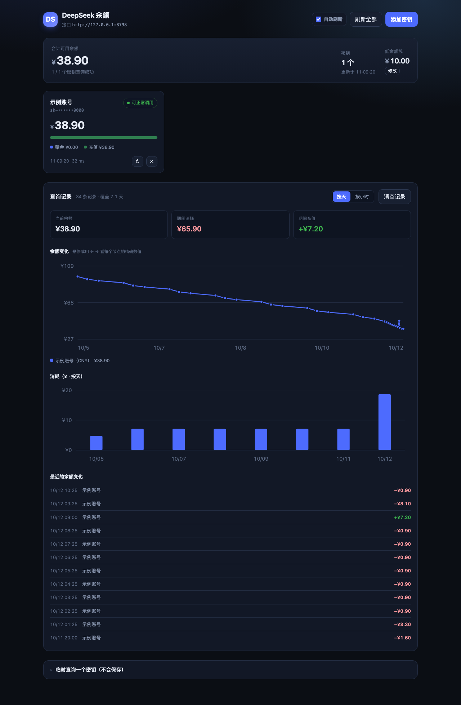
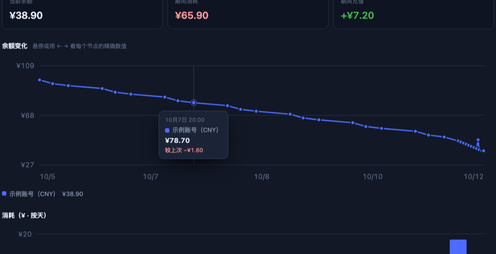

# DeepSeek 余额查询工具

> 查 DeepSeek API Key 的余额，每次查询自动记一笔，网页版画出余额曲线和每日消耗。
> Zero-dependency CLI + local web dashboard for DeepSeek API key balance and spending.

命令行和本地网页版两种用法，**零依赖**（只要有 Node.js 18+），密钥和数据全部留在你自己电脑上。



悬停查看任意节点的精确数值（也可以用 `←` `→` 键逐个看）：



---

## 功能

- **余额查询** —— 可用余额、赠金、充值余额，以及账户是否还能调用
- **本地仪表盘** —— 每个 Key 一张卡，大字余额、赠金/充值占比条，低于设定金额高亮
- **每次查询自动记账** —— 主动查询时把读数写进本地记录，攒起来就是历史
- **数据可视化** —— 余额变化曲线、消耗柱状图、最近的余额变化明细
- **悬停看精确节点** —— 鼠标移到曲线上任意一点，显示精确到分钟的时间和金额；键盘用 `←` `→` 逐个浏览
- **按天 / 按小时切换** —— 按天看长期趋势（近 30 天），按小时看最近 72 小时的消耗分布；横轴刻度跟着变
- **密钥只显示掩码** —— 完整密钥不打印、不写日志、不进网页响应
- **只监听 127.0.0.1** —— 校验 `Host` 和 `Origin`，挡住跨站调用和 DNS 重绑定
- **密钥不可能被提交** —— 三道机器锁，手滑也传不上去（见下）

---

## 密钥安全：只上传工具，密钥永远留在本地

这个仓库里**没有、也不会有**你的密钥。这不是靠"记得别提交"，而是三道锁锁死的：

### 第一道：`.gitignore`

`data/`、`keys.json`、`history.jsonl`、`.env`、`*.pem` 等一律不跟踪。

### 第二道：pre-commit 钩子（提交时自动拦截）

`.githooks/pre-commit` 会在每次 `git commit` 前扫描暂存区：

- 暂存内容里出现 `sk-xxxxx…` 这类密钥 → **拒绝提交**
- 暂存了 `data/`、`keys.json`、`.env`、`*.pem` 这类路径 → **拒绝提交**
- 甚至连 `git add -f data/keys.json` 强行绕过 `.gitignore` 也会被拦下

启用（克隆后执行一次，或 `npm install` 会自动跑）：

```bash
git config core.hooksPath .githooks
```

### 第三道：CI + 本地随时可查

```bash
npm run check-secrets     # 扫跟踪的文件 + 提交历史 + 整个对象库
```

GitHub Actions 里也独立跑一遍（`secrets` job），一旦有密钥混进任何一次提交，构建直接变红。

### 一个容易忽略的坑：`git add` 就已经写进 .git 了

`git add` 会**立刻**把文件内容写进 `.git/objects`，即使随后的 `git commit` 被钩子拒绝、或者你马上 `git reset` 撤销。

也就是说「提交被拦下了」≠「内容没进 .git」。这种游离对象（unreachable）**push 不出去**（push 只发送从分支可达的对象），但它会一直躺在你本地。想查出来：

```bash
node tests/check-secrets.mjs --objects     # 扫整个对象库，含游离对象
```

想清掉：

```bash
git reflog expire --expire=now --all && git gc --prune=now
```

> 三道锁都是拦"往仓库里写"的动作。你自己电脑上的 `data/keys.json` 不受任何影响，正常读写。

---

## 快速开始

### 网页版（推荐）

双击 **`启动网页版.command`**，浏览器会自动打开 <http://127.0.0.1:8788>。

Windows / Linux 上：

```bash
node ds-balance.mjs --serve --open
```

### 命令行

```bash
node ds-balance.mjs                 # 查询所有已保存的密钥
node ds-balance.mjs --add 主账号     # 添加一个密钥（输入时不显示，防止旁人看到）
node ds-balance.mjs --history       # 看查询记录与消耗明细
node ds-balance.mjs --serve         # 启动网页版
```

### 临时查一个 Key（不保存、不记账）

```bash
node ds-balance.mjs sk-你的密钥
```

---

## 输出示例

```
DeepSeek 余额  2026年10月11日 21:15:02

  主账号                                sk-••••••c3d4  312 ms
    状态      ✓ 可正常调用
    可用余额  ¥110.00
              赠金 ¥10.00  ·  充值 ¥100.00

  合计可用余额  ¥110.00
```

```
查询记录  12 条

  10/11 18:20  消耗  -¥6.61       主账号
  10/10 10:30  充值  +¥20.00      主账号
  10/09 10:30  消耗  -¥7.20       主账号

  期间消耗    ¥46.17
  期间充值    +¥24.50
```

---

## 数据是怎么来的（重要）

DeepSeek 官方**只开放了「查询余额」一个账户接口**，没有用量或账单接口（见[接口文档](https://api-docs.deepseek.com/api/get-user-balance)）。所以消耗只能这样推算：

```
每次你主动查询余额  →  相邻两次读数做差
    余额下降  =  消耗
    余额上升  =  充值 / 赠金到账
```

几个需要知道的点：

| 说明 | 细节 |
| --- | --- |
| 只在主动查询时记录 | CLI 查询、网页版「刷新全部」「单卡刷新」会记录；**60 秒自动刷新不记录**，否则挂一天就是上千条噪声 |
| 余额没变就不重复记 | 与上一条完全相同且间隔不到 60 秒，跳过 |
| 查得越勤越准 | 两次查询之间的消耗会整体归到后一次的时间点上 |
| 赠金过期分不出来 | 余额下降一律算消耗，但赠金到期也会让余额下降 |
| 记录之前是空白 | 开始记录之前的日期不会画进图表，那是「未知」不是「零」 |
| 临时查询不记录 | `node ds-balance.mjs sk-xxx` 不落盘、不进历史 |

想要**精确到每次调用的 token 和费用**，得在调用侧自己记账（比如给应用加一层代理记录响应里的 `usage` 字段）。这个工具做的是「不改任何现有代码，也能知道钱花到哪去了」。

---

## 全部命令

| 命令 | 说明 |
| --- | --- |
| `node ds-balance.mjs` | 查询所有已保存的密钥 |
| `node ds-balance.mjs sk-xxx` | 临时查询一个密钥，不保存、不记录 |
| `--add [名称]` | 添加密钥（用 `--key` 可直接传入，跳过交互） |
| `--list` | 列出已保存的密钥（只显示掩码） |
| `--remove <名称\|序号>` | 删除密钥，需要 `y` 确认，加 `-y` 跳过 |
| `--history [条数]` | 查看查询记录与消耗/充值明细 |
| `--clear-history` | 清空查询记录，需要确认 |
| `--serve` | 启动本地网页版 |

| 选项 | 说明 |
| --- | --- |
| `-k, --key <sk-…>` | 直接提供密钥 |
| `--name <名称>` | 配合 `--add` 指定名称 |
| `--json` | 输出 JSON，方便接到脚本或状态栏 |
| `--no-record` | 这次查询不写进记录 |
| `-y, --yes` | 跳过删除、清空等确认 |
| `--port <端口>` | 网页版端口，默认 `8788`（被占用会自动往后找） |
| `--open` | 启动后自动打开浏览器 |
| `--base-url <地址>` | 换接口地址，默认 `https://api.deepseek.com` |
| `--timeout <毫秒>` | 单次请求超时，默认 `15000` |

退出码：`0` 成功、`1` 查询或参数出错、`2` 用法错误。

`--json` 很适合做告警：

```bash
# 余额低于 ¥10 就报警
node ds-balance.mjs --json | jq -e '[.results[].balances[].total] | min > 10' > /dev/null || echo "余额不足！"
```

---

## HTTP 接口

网页版跑起来后，本机可以直接调（只监听 127.0.0.1）：

| 方法 | 路径 | 说明 |
| --- | --- | --- |
| `GET` | `/api/state` | 已保存的密钥（掩码）与配置 |
| `POST` | `/api/keys` | 新增密钥 `{name, key}` |
| `DELETE` | `/api/keys/:id` | 删除密钥 |
| `POST` | `/api/query` | 查询单个密钥 `{id, record?}` |
| `POST` | `/api/query-all` | 查询全部 `{record?}`，`record:false` 时不写记录 |
| `POST` | `/api/query-raw` | 临时查询 `{key}`，不落盘不记录 |
| `GET` | `/api/history?days=30` | 查询记录与画图数据（含按天/按小时两套桶） |
| `DELETE` | `/api/history` | 清空记录，需要 `{confirm:true}` |

---

## 数据存在哪

| 文件 | 内容 | 权限 |
| --- | --- | --- |
| `data/keys.json` | 密钥 | 600 |
| `data/history.jsonl` | 查询记录，每行一条读数，追加写入 | 600 |

- 目录权限 `700`，只有你自己的账户能读。
- 完整密钥不会出现在屏幕、日志或网页响应里，一律显示成 `sk-••••••c3d4`。
- 记录是追加写入的 JSONL，写一半断电也不会损坏已有数据；解析不了的行会被跳过。
- **`data/` 已加进 `.gitignore`，且额外有 pre-commit 钩子和 CI 双重拦截。**
- 想换存储位置，设置环境变量 `DS_BALANCE_HOME`。

> 这是给本机用的私人工具，密钥以明文存在 `data/keys.json`。电脑多人共用的话，建议改用系统钥匙串，或者只用「临时查询」模式。

---

## 环境变量

| 变量 | 作用 |
| --- | --- |
| `DS_BALANCE_BASE_URL` | 覆盖接口地址（走自建网关时用） |
| `DS_BALANCE_HOME` | 数据存储目录，默认 `./data` |
| `DS_BALANCE_PORT` | 网页版默认端口 |
| `NO_COLOR` | 设为任意值关闭彩色输出 |

---

## 常见问题

| 提示 | 原因与处理 |
| --- | --- |
| 密钥无效或已被撤销（HTTP 401） | 复制不完整、多了空格，或密钥已被删除。去 [platform.deepseek.com](https://platform.deepseek.com/api_keys) 重新生成。 |
| 账户余额不足（HTTP 402） | 余额用完了，接口已拒绝调用，充值即可。 |
| 请求过于频繁（HTTP 429） | 短时间查太多次，等一会儿再查。 |
| 请求超时 / 无法连接 | 检查网络；用了代理或自建网关的话，用 `--base-url` 指定地址。 |
| 图表是空的 | 至少要有 2 条记录才画得出曲线。多查几次就有了。 |

---

## 开发

```bash
node tests/self-test.mjs
```

用本地 mock 接口跑全套自动化测试，**不消耗真实额度**。当前 141 项，覆盖：

- CLI 各分支、密钥增删改查、文件权限
- 查询记录的写入、去重、`--no-record`
- 消耗/充值推算、跨天聚合、`days` 参数
- Web 全部接口、跨站与 DNS 重绑定防护
- 网页界面的**实际渲染结果**（用真实 `ui.html` 脚本 + 极简 DOM 在 Node 里跑）
- **CSS 类名冲突审查**
- **密钥泄露检查**（跟踪文件 + 提交历史 + 对象库游离副本 + 钩子是否启用）
- 图表：桶的时间边界按**本地时区**对齐、悬停基础设施、粒度切换

### 关于 CSS 审查

`tests/css-audit.mjs` 检查「裸类名泄漏」：同一个类名如果既有 `.foo { ... }` 这样的裸规则，又出现在别的元素上（`header.foo`）或别人的子树里（`.other .foo`），裸规则就会顺着级联作用到那些元素上。

这个检查是补一个真实事故加的：顶栏曾经写成 `<header class="bar">`，而余额卡片的占比条用了 `.bar { height: 7px; overflow: hidden }` —— 结果整个顶栏被压成 7px 高，logo 和标题全被裁掉。

---

## 目录结构

```
.
├── ds-balance.mjs             主程序（命令行 + 本地服务，零依赖）
├── ui.html                    网页界面（样式和脚本都内联，单文件）
├── 启动网页版.command           macOS 双击启动
├── screenshot.png             界面截图
├── screenshot-hover.png       悬停交互截图
├── AGENTS.md                  给 AI 代理 / 协作者的约定
├── .githooks/pre-commit       提交前拦截密钥
├── .github/workflows/test.yml CI：自测 + 密钥扫描
├── tests/
│   ├── self-test.mjs          自动化测试
│   ├── check-secrets.mjs      密钥泄露检查
│   └── css-audit.mjs          CSS 类名冲突审查
├── data/                      密钥与记录（首次运行后生成，不入库）
├── LICENSE                    MIT
└── README.md
```

想全局使用 `ds-balance` 命令，在本目录执行 `npm link`。

---

## License

[MIT](LICENSE)
